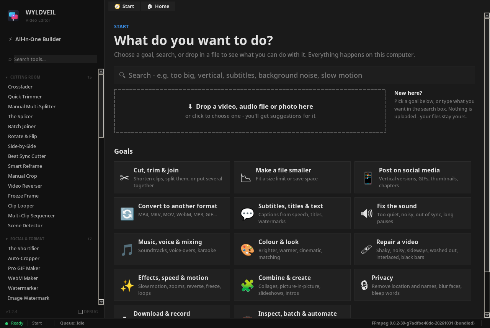
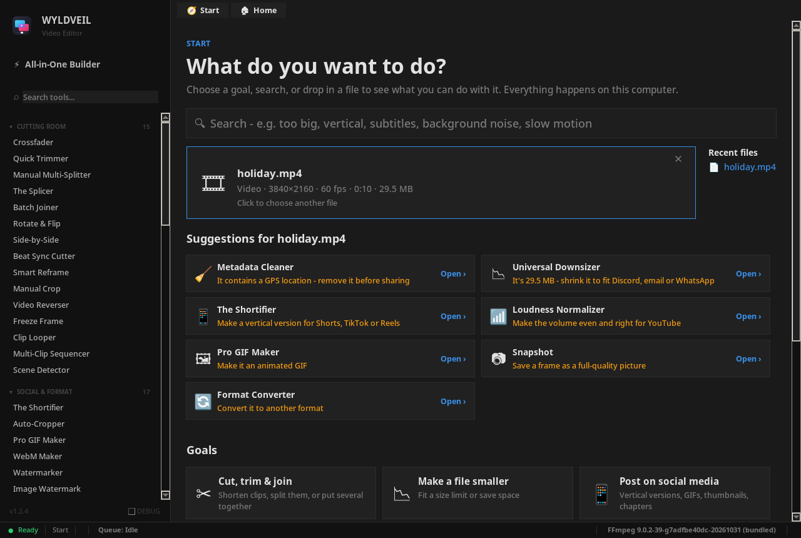
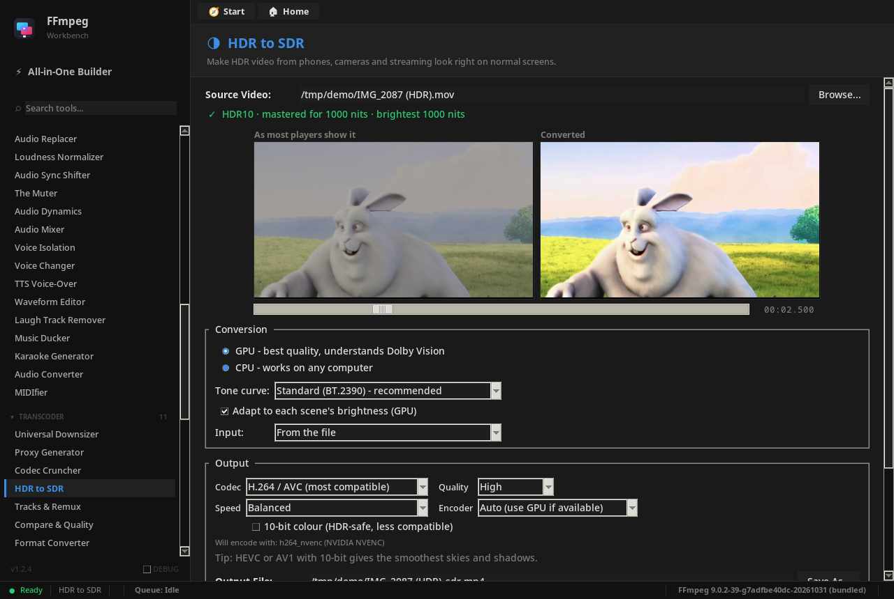
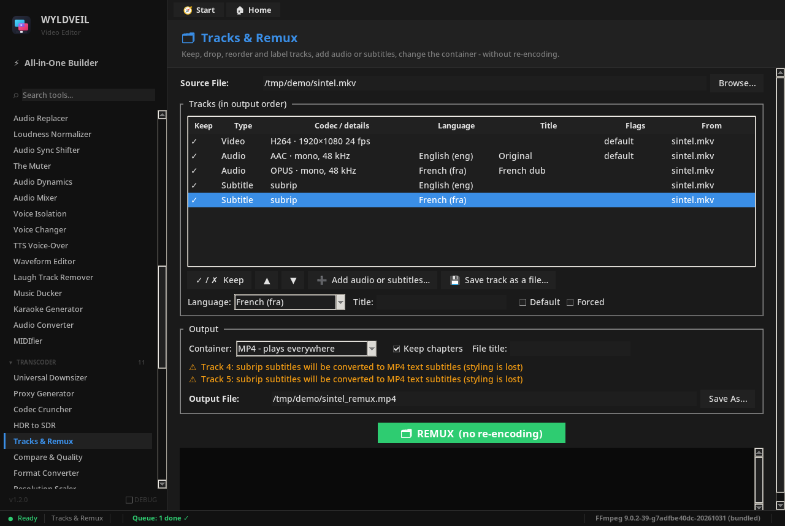
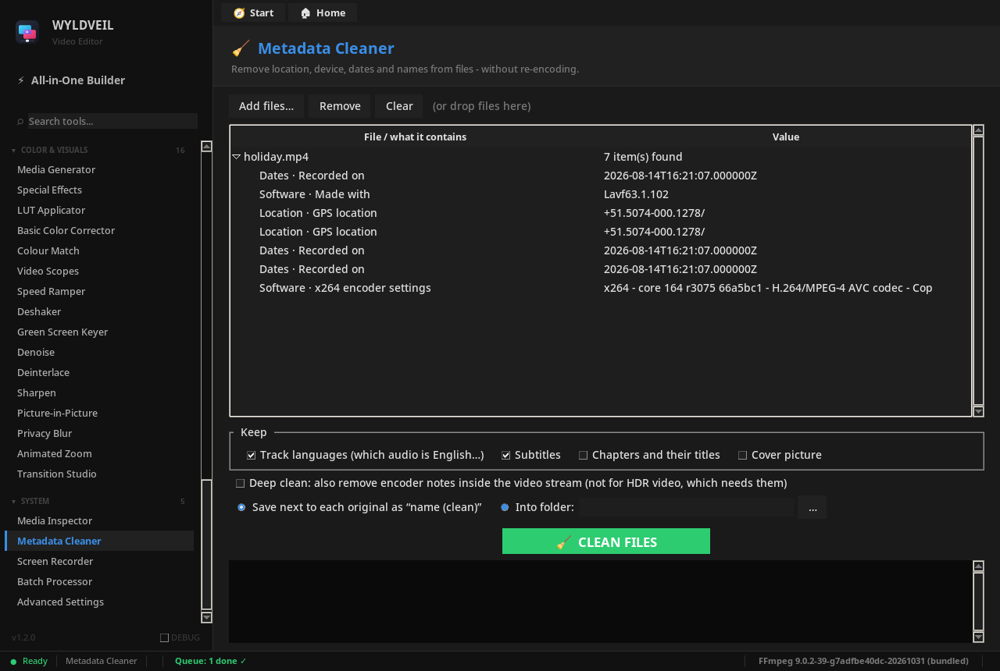

# WyldVeil's Media Editor

[](https://ko-fi.com/wyldveil)

**80 video and audio tools in one free app.** Cut, join, convert, compress,
subtitle, upscale, fix the sound, clean up old footage and get videos ready for
social media. Everything runs on your own computer.



A completely free, open-source video and audio processing suite. You don't need
any editing knowledge: tell it what you want to do, or drop in a file and it
suggests what you can do with it.

## Download

Get the file for your system from the **[Releases page](https://github.com/WyldVeil/wyldveils-media-editor/releases/latest)**.

| System | Download | Install |
|---|---|---|
| **Windows 10 / 11** (64-bit) | `WyldVeils-Media-Editor_1.2.1_Windows_Setup.exe` | Run it. An earlier version is upgraded in place. |
| **Ubuntu** | `wyldveils-media-editor_1.2.1_ubuntu_amd64.deb` | `sudo apt install ./wyldveils-media-editor_1.2.1_ubuntu_amd64.deb` |
| **Debian** | `wyldveils-media-editor_1.2.1_debian_amd64.deb` | `sudo apt install ./wyldveils-media-editor_1.2.1_debian_amd64.deb` |
| **Fedora** | `wyldveils-media-editor-1.2.1-fedora.tar.gz` | Extract it, then run `./install.sh` |
| **Arch** | `wyldveils-media-editor-1.2.1-arch.tar.gz` | Extract it, then run `makepkg -si` (or `./install.sh`) |

Everything is included: FFmpeg, the downloader, offline speech recognition, the
upscalers and the app's own Python. Nothing else needs to be set up.

## What's new in 1.2.0

<table>
<tr>
<td width="50%"></td>
<td width="50%"></td>
</tr>
<tr>
<td><b>A Start page that knows what you want.</b> Pick a goal, search in plain words ("too big", "vertical", "background noise"), or drop in a file. Here, a phone clip contains a GPS location, so the first suggestion is to remove it before sharing.</td>
<td><b>HDR to SDR.</b> HDR video from phones and cameras looks grey and washed out in most apps. This converts it properly: HDR10, HDR10+, HLG and Dolby Vision, using the graphics card for the best result.</td>
</tr>
<tr>
<td></td>
<td></td>
</tr>
<tr>
<td><b>Compare & Quality.</b> How much did that compression really cost? You get VMAF, SSIM and PSNR, the worst moments, and both versions side by side.</td>
<td><b>Video Collage.</b> Any number of clips on one screen. The layout keeps every clip as large as possible, and shorter clips can loop.</td>
</tr>
<tr>
<td></td>
<td></td>
</tr>
<tr>
<td><b>Tracks & Remux.</b> Choose which audio and subtitle tracks to keep, label their languages, add new ones, and switch between MKV and MP4. Nothing is re-encoded.</td>
<td><b>Metadata Cleaner.</b> Removes GPS location, phone model, dates and names before you share a video, without touching the picture or sound.</td>
</tr>
</table>

Also new:

- **Upscaling with FSR, NIS and AI** (ArtCNN, Anime4K) in the Resolution Scaler.
- **Offline subtitles** from speech, powered by whisper.cpp. No uploads and no
  account.
- **A command line for scripts and AI assistants** (see below).

Every tool was rebuilt and tested on real files. See the
[changelog](CHANGELOG.md) for everything.

## Everything inside

| | |
|---|---|
| ✂ **Cutting room** | Quick Trimmer · Crossfader · Splicer · Batch Joiner · Multi-Splitter · Multi-Clip Sequencer · Scene Detector · Beat Sync Cutter · Smart Reframe · Side-by-Side · Manual Crop · Rotate & Flip · Video Reverser · Freeze Frame · Clip Looper |
| 📱 **Social & format** | Shortifier (Shorts / TikTok / Reels) · Auto-Cropper · GIF Maker · WebM Maker · Watermarks · Auto-Subtitles · Hard-Subber · Animated Titles · Intro/Outro Maker · Slideshow Maker · Frame Extractor · Thumbnail Maker · Chapter Markers · Video Collage · Video Downloader |
| 🔊 **Audio** | Loudness Normalizer · Voice Isolation · Silence Remover · Audio Mixer · Music Ducker · Audio Replacer · Audio Sync Shifter · The Muter · Audio Dynamics · Voice Changer · TTS Voice-Over · Waveform Editor · Laugh Track Remover · Karaoke Generator · Audio Converter · Audio Extractor · MIDIfier |
| ⚙ **Transcoder** | Universal Downsizer · Codec Cruncher · HDR to SDR · Tracks & Remux · Compare & Quality · Format Converter · Resolution Scaler (with FSR/NIS/AI upscaling) · Framerate Interpolator · Proxy Generator · Encode Queue · Preset Manager |
| 🎨 **Colour & visuals** | Basic Color Corrector · LUT Applicator · Colour Match · Video Scopes · Special Effects · Speed Ramper · Deshaker · Green Screen Keyer · Denoise · Sharpen · Deinterlace · Picture-in-Picture · Privacy Blur · Animated Zoom · Transition Studio · Media Generator |
| 🛠 **System** | Media Inspector · Metadata Cleaner · Screen Recorder · Batch Processor · All-in-One Builder |

There are [screenshots of every tool](screenshots/) in the screenshots folder.


## Private by design

- Your files never leave your computer. Every tool works locally.
- The network is used only for the Video Downloader, the optional online voices
  in TTS Voice-Over, and checking for yt-dlp updates. All of that can be switched
  off.
- It works behind company proxies, VPNs and filtered networks. If you need to
  set those up, the network settings are under *Advanced Settings*.
- Results never replace your files unless you say so, and a failed or cancelled
  job never leaves a half-written file.

## For scripts and AI assistants

Most of the app's work is available from a terminal without opening the window:

```sh
wyldveils-media-editor --cli tools                          # what it can do
wyldveils-media-editor --cli compress clip.mp4 --size 10MB  # make a video fit Discord
wyldveils-media-editor --cli subtitles talk.mp4 --burn      # subtitles from speech, burned in
wyldveils-media-editor --cli hdr-to-sdr IMG_2087.MOV
```

On Windows, use `wme-cli.bat` in the install folder. [AGENTS.md](AGENTS.md)
tells AI assistants how to use the app safely: every operation, the rules (it
never overwrites your files), and recipes for common requests. If you ask an
assistant to do something to your videos, point it at that file.

## 🌍 Multilingual

The interface is available in 28 languages. You can switch at any time in
*Advanced Settings*. The tools added in 1.2.0 are in English for now.

| | | |
|---|---|---|
| English (US) | English (GB) | العربية |
| বাংলা | Deutsch | Español |
| فارسی | Français | हिन्दी |
| Bahasa Indonesia | Italiano | 日本語 |
| 한국어 | Bahasa Melayu | Nederlands |
| Naijá Pidgin | Polski | Português (Brasil) |
| Română | Русский | Kiswahili |
| ภาษาไทย | Filipino | Türkçe |
| Українська | اردو | Tiếng Việt |
| 中文 | | |

## Uninstall

- **Windows:** use *Add or Remove Programs* in Settings, or the uninstaller in
  the Start Menu.
- **Ubuntu / Debian:** `sudo apt remove wyldveils-media-editor`
- **Fedora:** run `./uninstall.sh` from the extracted folder.
- **Arch:** `sudo pacman -R wyldveils-media-editor`, or `./uninstall.sh`

Your settings stay in your user folder in case you come back.

## Under the hood

The app is written in Python with Tkinter. The work is done by bundled, pinned
copies of:

| Tool | Version | Used for |
|---|---|---|
| [FFmpeg](https://ffmpeg.org/) | 9.0.2 | All video and audio processing, with libplacebo, libvmaf, rubberband and more |
| [yt-dlp](https://github.com/yt-dlp/yt-dlp) | 2026.10.26 | Video Downloader |
| [Deno](https://deno.com/) | 2.9.8 | Lets yt-dlp handle YouTube's challenges |
| [whisper.cpp](https://github.com/ggml-org/whisper.cpp) | b5454 | Offline speech-to-text (Auto-Subtitles, Karaoke) |
| [FluidSynth](https://www.fluidsynth.org/) + GeneralUser GS SoundFont | 2.6.2 on Windows (Linux uses the system's copy) | MIDIfier playback |
| FSR, NIS, ArtCNN, Anime4K shaders | | Upscaling in the Resolution Scaler |

Every download is checked against a SHA-256 checksum
(`scripts/binaries.lock.json`). Their licences and sources are listed in
[THIRD_PARTY_NOTICES.md](THIRD_PARTY_NOTICES.md).

### Running from source

```sh
python scripts/fetch_binaries.py --platform linux-x64   # or windows-x64: fetches the pinned tools
python main.py
python -m pytest -q                                     # the test suite renders real files
python packaging/release.py --linux                     # build the release packages
```

See [docs/DEVELOPING.md](docs/DEVELOPING.md) for more.

## License

All bundled third-party tools keep their original licences (FFmpeg: GPL, yt-dlp:
Unlicense, FluidSynth: LGPL-2.1, whisper.cpp and Deno: MIT, upscaling shaders:
MIT; see THIRD_PARTY_NOTICES.md). The application code is provided as-is.

The screenshots use footage from *Big Buck Bunny* and *Sintel*, © Blender
Foundation, licensed CC BY 3.0 ([peach.blender.org](https://peach.blender.org),
[durian.blender.org](https://durian.blender.org)).
